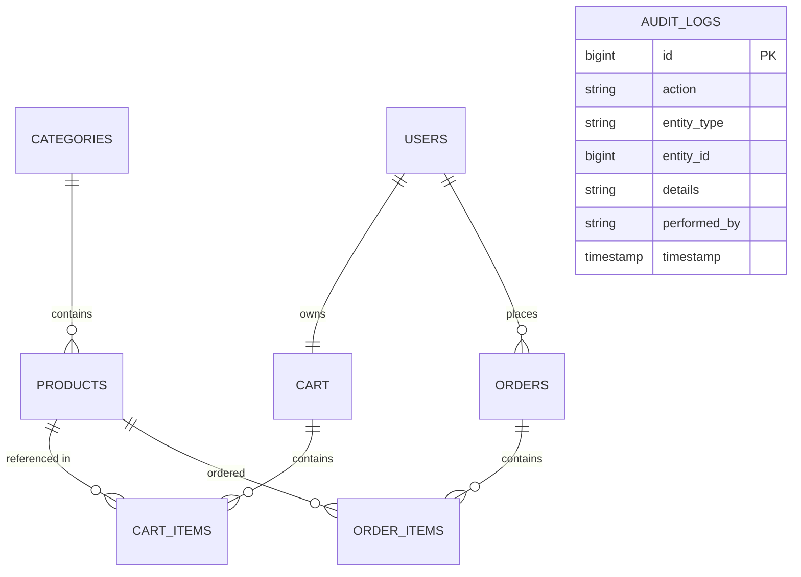

# Online Shopping Cart and Order Management System
> **University Case Study Project:** OOPs Using Java & Spring Boot / JDBC  
> **Course:** Object-Oriented Programming Using Java (2nd Year Computer Science & Engineering)

---

## 1. Project Overview & University Case Study Alignment

This project is an enterprise-grade, university-level web application designed and built for the **Online Shopping Cart and Order Management System** case study. It demonstrates how core Object-Oriented Programming (OOP) principles, relational database transactions, and database connectivity architectures are applied to build a real-world e-commerce platform.

### University Case Study Specification
* **Objective:** A retail business system maintaining products, customer profiles, shopping cart state, and purchase orders.
* **Key Academic Requirements:**
  - Maintain a database of products, categories, customers, and orders.
  - Implement product searching, faceted filtering, and atomic inventory updates.
  - Develop robust shopping cart mechanics (add, update, remove, stock validation).
  - Compute financial amounts with polymorphic discount strategies and sales tax.
  - Use database transactions to enforce consistency and prevent overselling.
  - Implement Spring Boot with annotations, `@Service`, `@Repository`, and `JdbcTemplate`.
  - Implement Traditional JDBC (`DriverManager`, `Connection`, `PreparedStatement`, `ResultSet`, explicit commit/rollback) and present a side-by-side empirical comparison.

---

## 2. Technology Stack

| Layer | Technology | Details |
|---|---|---|
| **Programming Language** | **Java 17 (LTS)** | Records, Stream API, Sealed classes, Method references |
| **Backend Framework** | **Spring Boot 3.2.5** | Spring MVC, Spring JDBC, Spring Transaction Management |
| **Persistence (Spring)** | **Spring JDBC** | `JdbcTemplate`, `RowMapper<T>`, `@Repository`, `@Transactional` |
| **Persistence (Traditional)**| **Traditional JDBC** | `DriverManager`, `Connection`, `PreparedStatement`, `ResultSet`, manual transactions |
| **Database Engines** | **MySQL 8.0 & H2** | Primary: MySQL 8.0+; Zero-config embedded fallback: H2 in MySQL mode |
| **Security & Hashing** | **BCrypt** | `BCryptPasswordEncoder` (10 rounds); zero plain-text passwords |
| **Template Engine** | **Thymeleaf 3.1** | Server-rendered HTML5 with modular layout fragments |
| **Frontend Styling** | **CSS3, Bootstrap 5, SVG** | Custom modern minimalist design system, responsive grids, local vector illustrations |
| **Build & Tooling** | **Apache Maven 3.9** | Multi-phase lifecycle, automated test runners |

---

## 3. Mandatory Java OOP Concepts Mapping

Every OOP concept required by university examiners is purposefully implemented in production code:

```
                                  [BaseEntity] (Abstraction)
                                       ▲
              ┌────────────────────────┼────────────────────────┐
              │                        │                        │
          [User]                   [Product]                 [Order]
        (Encapsulation)        (Comparable<Product>)      (Composition)
              ▲
      ┌───────┴───────┐
      │               │
  [Customer]       [Admin]
(Inheritance & Polymorphism)
```

### 1. Classes and Objects
* **Implementation:** Domain entities accurately represent business objects:
  - [`Product`](file:///home/abhyudaya/onlinecartmanagement/src/main/java/com/university/cartmanagement/model/Product.java): Physical inventory items with attributes (`name`, `price`, `stockQuantity`, `category`).
  - [`Order`](file:///home/abhyudaya/onlinecartmanagement/src/main/java/com/university/cartmanagement/model/Order.java) and [`OrderItem`](file:///home/abhyudaya/onlinecartmanagement/src/main/java/com/university/cartmanagement/model/OrderItem.java): Complete purchase transactions.
  - [`Cart`](file:///home/abhyudaya/onlinecartmanagement/src/main/java/com/university/cartmanagement/model/Cart.java) and [`CartItem`](file:///home/abhyudaya/onlinecartmanagement/src/main/java/com/university/cartmanagement/model/CartItem.java): Ephemeral shopping cart sessions.

### 2. Encapsulation
* **Implementation:**
  - All class fields are declared `private` or `protected`.
  - Mutators validate business invariants before state changes. For example, in [`Product.java`](file:///home/abhyudaya/onlinecartmanagement/src/main/java/com/university/cartmanagement/model/Product.java), `reduceStock(int quantity)` asserts inventory availability and throws an exception before decrementing.
  - Passwords are encrypted via BCrypt and never exposed via plain getter methods.

### 3. Inheritance
* **Implementation:**
  - [`BaseEntity.java`](file:///home/abhyudaya/onlinecartmanagement/src/main/java/com/university/cartmanagement/model/BaseEntity.java) is the abstract superclass providing `id`, `createdAt`, `updatedAt`, `equals()`, and `hashCode()` to `User`, `Product`, `Category`, `Order`, `Cart`, and `AuditLog`.
  - [`Customer.java`](file:///home/abhyudaya/onlinecartmanagement/src/main/java/com/university/cartmanagement/model/Customer.java) and [`Admin.java`](file:///home/abhyudaya/onlinecartmanagement/src/main/java/com/university/cartmanagement/model/Admin.java) extend `User.java`, adding specialized state (e.g., `loyaltyPoints`, `department`).
  - [`PercentageDiscountStrategy`](file:///home/abhyudaya/onlinecartmanagement/src/main/java/com/university/cartmanagement/service/discount/PercentageDiscountStrategy.java) and [`FlatDiscountStrategy`](file:///home/abhyudaya/onlinecartmanagement/src/main/java/com/university/cartmanagement/service/discount/FlatDiscountStrategy.java) extend [`AbstractDiscountStrategy`](file:///home/abhyudaya/onlinecartmanagement/src/main/java/com/university/cartmanagement/service/discount/AbstractDiscountStrategy.java).

### 4. Polymorphism
* **Runtime Polymorphism (Dynamic Method Dispatch):**
  - **Discount Strategy Pattern:** The [`DiscountStrategy`](file:///home/abhyudaya/onlinecartmanagement/src/main/java/com/university/cartmanagement/service/discount/DiscountStrategy.java) interface defines `calculateDiscount(BigDecimal subtotal)`. At runtime, `PercentageDiscountStrategy` and `FlatDiscountStrategy` execute distinct algorithms dynamically based on promo codes.
  - **Payment Processors:** The [`PaymentProcessor`](file:///home/abhyudaya/onlinecartmanagement/src/main/java/com/university/cartmanagement/service/payment/PaymentProcessor.java) interface is implemented by `CardPaymentProcessor`, `UPIPaymentProcessor`, and `CashOnDeliveryProcessor`.
  - **Repository Pattern:** Both [`SpringJdbcProductRepository`](file:///home/abhyudaya/onlinecartmanagement/src/main/java/com/university/cartmanagement/repository/impl/SpringJdbcProductRepository.java) and [`TraditionalJdbcProductRepository`](file:///home/abhyudaya/onlinecartmanagement/src/main/java/com/university/cartmanagement/repository/traditional/TraditionalJdbcProductRepository.java) implement the `ProductRepository` interface.
* **Compile-Time Polymorphism (Method Overloading):**
  - [`ProductService.searchProducts(String keyword)`](file:///home/abhyudaya/onlinecartmanagement/src/main/java/com/university/cartmanagement/service/ProductService.java) vs [`ProductService.searchProducts(String keyword, Long categoryId, BigDecimal minPrice, BigDecimal maxPrice, String sortBy)`](file:///home/abhyudaya/onlinecartmanagement/src/main/java/com/university/cartmanagement/service/ProductService.java).
  - [`CartService.addToCart(Long userId, Long productId)`](file:///home/abhyudaya/onlinecartmanagement/src/main/java/com/university/cartmanagement/service/CartService.java) vs [`CartService.addToCart(Long userId, Long productId, int quantity)`](file:///home/abhyudaya/onlinecartmanagement/src/main/java/com/university/cartmanagement/service/CartService.java).
  - [`DiscountCalculator.calculateDiscount(String code, BigDecimal subtotal)`](file:///home/abhyudaya/onlinecartmanagement/src/main/java/com/university/cartmanagement/service/discount/DiscountCalculator.java) vs [`DiscountCalculator.calculateDiscount(BigDecimal subtotal)`](file:///home/abhyudaya/onlinecartmanagement/src/main/java/com/university/cartmanagement/service/discount/DiscountCalculator.java).

### 5. Abstraction
* **Implementation:**
  - Interfaces: `ProductRepository`, `UserRepository`, `CartRepository`, `OrderRepository`, `CategoryRepository`, `AuditRepository`, `PaymentProcessor`, `DiscountStrategy`.
  - Abstract Classes: `BaseEntity`, `AbstractDiscountStrategy`.

### 6. Constructors and Constructor Chaining
* **Implementation:**
  - Default constructors, overloaded constructors, and explicit constructor chaining using `this(...)` and `super(...)` are implemented across `User.java`, `Product.java`, and `Order.java`.

### 7. Method Overriding
* **Implementation:**
  - Explicitly annotated with `@Override`: `equals()`, `hashCode()`, `toString()`, `compareTo()`, and polymorphic service methods (`calculateDiscount()`, `getRoleDescription()`).

### 8. Exception Handling Hierarchy
* **Implementation:**
  - Custom exception hierarchy rooted in [`CartException`](file:///home/abhyudaya/onlinecartmanagement/src/main/java/com/university/cartmanagement/exception/CartException.java):
    - `ResourceNotFoundException`: HTTP 404 handler
    - `InsufficientStockException`: Inventory guard
    - `AuthenticationException`: Security guard
    - `DatabaseOperationException`: JDBC wrapper
  - Handled via Spring's [`GlobalExceptionHandler`](file:///home/abhyudaya/onlinecartmanagement/src/main/java/com/university/cartmanagement/exception/GlobalExceptionHandler.java) (`@ControllerAdvice`).

### 9. Collections Framework & Stream API
* **Implementation:**
  - `List<CartItem>` and `List<OrderItem>` manipulated via Streams (`filter`, `map`, `reduce`, `collect`).
  - `Map<String, DiscountStrategy>` and `Map<PaymentMethod, PaymentProcessor>` for O(1) strategy dispatch.
  - `Comparable<Product>` with `Comparator` sorting in catalog queries.

---

## 4. Traditional JDBC vs Spring JDBC Comparison

The application provides a dedicated interactive benchmark page at **`/admin/jdbc-comparison`** demonstrating both architectures side-by-side:

| Feature / Aspect | Traditional JDBC | Spring JDBC (`JdbcTemplate`) |
|---|---|---|
| **Class Used** | `java.sql.DriverManager` | `org.springframework.jdbc.core.JdbcTemplate` |
| **Connection Pooling** | None by default; manual socket opening | Integrated with `HikariDataSource` connection pool |
| **Boilerplate Code** | ~25 lines per method (connection, statement, cursor loop, close) | 3-5 lines per method (template callbacks) |
| **Resource Management** | Manual `try-with-resources` or `finally` blocks | Automated resource cleanup back to pool |
| **Row Extraction** | Manual cursor loop: `while (rs.next()) { rs.getString(...) }` | Declarative mapping using `RowMapper<T>` functional interfaces |
| **Exception Handling** | Checked `java.sql.SQLException` | Rich unchecked `org.springframework.dao.DataAccessException` |
| **Transactions** | Manual: `conn.setAutoCommit(false)`, `conn.commit()`, `conn.rollback()` | Declarative: `@Transactional(rollbackFor = Exception.class)` |

### Side-by-Side Code Comparison

#### Traditional JDBC Implementation (`TraditionalJdbcProductRepository.java`):
```java
public Optional<Product> findById(Long id) {
    String sql = "SELECT * FROM products WHERE id = ?";
    // 1. Manually open connection via DriverManager
    try (Connection conn = DriverManager.getConnection(url, user, pass);
         PreparedStatement ps = conn.prepareStatement(sql)) {

        // 2. Set parameter index manually
        ps.setLong(1, id);

        // 3. Execute query and obtain ResultSet
        try (ResultSet rs = ps.executeQuery()) {
            if (rs.next()) {
                // 4. Manually extract each column from cursor
                Product p = new Product();
                p.setId(rs.getLong("id"));
                p.setName(rs.getString("name"));
                p.setPrice(rs.getBigDecimal("price"));
                p.setStockQuantity(rs.getInt("stock_quantity"));
                return Optional.of(p);
            }
        }
        return Optional.empty();
    } catch (SQLException e) {
        // 5. Must catch checked SQLException
        throw new DatabaseOperationException("Traditional JDBC error", sql, e);
    }
}
```

#### Spring JDBC Implementation (`SpringJdbcProductRepository.java`):
```java
public Optional<Product> findById(Long id) {
    String sql = "SELECT * FROM products WHERE id = ?";
    try {
        // Automatically borrows connection from HikariCP pool,
        // maps columns via RowMapper, and releases connection safely.
        Product product = jdbcTemplate.queryForObject(sql, productRowMapper, id);
        return Optional.ofNullable(product);
    } catch (EmptyResultDataAccessException e) {
        return Optional.empty();
    }
}
```

---

## 5. Database Schema & Architecture

The database initialization scripts are located at:
* [`database/schema.sql`](file:///home/abhyudaya/onlinecartmanagement/database/schema.sql): Complete DDL with primary keys, foreign keys, unique constraints, and indexes.
* [`database/data.sql`](file:///home/abhyudaya/onlinecartmanagement/database/data.sql): Seed data with 5 categories, 12 products, 3 users, sample carts, orders, and audit logs.

### Relational Entity-Relationship Diagram



---

## 6. Project Directory Structure

```
onlinecartmanagement/
├── pom.xml                               # Maven project descriptor & dependencies
├── mvnw                                  # Maven wrapper script
├── README.md                             # Comprehensive project documentation
├── database/
│   ├── schema.sql                        # DDL table creation script
│   └── data.sql                          # Initial seed data
├── src/
│   ├── main/
│   │   ├── java/com/university/cartmanagement/
│   │   │   ├── OnlineCartApplication.java # Spring Boot entry point & seed runner
│   │   │   ├── config/
│   │   │   │   └── WebMvcConfig.java     # Interceptors, global attributes, security
│   │   │   ├── controller/
│   │   │   │   ├── HomeController.java   # Landing homepage & about views
│   │   │   │   ├── AuthController.java   # Login, registration, profile
│   │   │   │   ├── ProductController.java# Product catalog & details
│   │   │   │   ├── CartController.java   # Cart CRUD & coupon logic
│   │   │   │   ├── OrderController.java  # Checkout & order history
│   │   │   │   ├── AdminController.java  # Admin dashboard & management
│   │   │   │   └── JdbcComparisonController.java # Live benchmark view
│   │   │   ├── service/
│   │   │   │   ├── UserService.java      # Auth & user business logic
│   │   │   │   ├── ProductService.java   # Catalog & inventory management
│   │   │   │   ├── CartService.java      # Cart calculations & stock checks
│   │   │   │   ├── OrderService.java     # ACID order placement & transactions
│   │   │   │   ├── CategoryService.java  # Category CRUD
│   │   │   │   ├── discount/             # Polymorphic Discount Strategy Pattern
│   │   │   │   │   ├── DiscountStrategy.java
│   │   │   │   │   ├── AbstractDiscountStrategy.java
│   │   │   │   │   ├── PercentageDiscountStrategy.java
│   │   │   │   │   ├── FlatDiscountStrategy.java
│   │   │   │   │   └── DiscountCalculator.java
│   │   │   │   └── payment/              # Polymorphic Payment Processors
│   │   │   │       ├── PaymentProcessor.java
│   │   │   │       ├── CardPaymentProcessor.java
│   │   │   │       ├── UPIPaymentProcessor.java
│   │   │   │       └── CashOnDeliveryProcessor.java
│   │   │   ├── repository/
│   │   │   │   ├── CategoryRepository.java
│   │   │   │   ├── ProductRepository.java
│   │   │   │   ├── UserRepository.java
│   │   │   │   ├── CartRepository.java
│   │   │   │   ├── OrderRepository.java
│   │   │   │   ├── AuditRepository.java
│   │   │   │   ├── impl/                 # Spring JDBC Implementations
│   │   │   │   │   ├── SpringJdbcCategoryRepository.java
│   │   │   │   │   ├── SpringJdbcProductRepository.java
│   │   │   │   │   ├── SpringJdbcUserRepository.java
│   │   │   │   │   ├── SpringJdbcCartRepository.java
│   │   │   │   │   └── SpringJdbcOrderRepository.java
│   │   │   │   └── traditional/          # Traditional JDBC Implementations
│   │   │   │       ├── TraditionalJdbcProductRepository.java
│   │   │   │       └── TraditionalJdbcAuditRepository.java
│   │   │   ├── model/                    # OOP Domain Model Hierarchy
│   │   │   │   ├── BaseEntity.java       # Abstract base entity
│   │   │   │   ├── User.java
│   │   │   │   ├── Customer.java         # Subclass of User
│   │   │   │   ├── Admin.java            # Subclass of User
│   │   │   │   ├── Role.java
│   │   │   │   ├── Product.java          # Implements Comparable<Product>
│   │   │   │   ├── Category.java
│   │   │   │   ├── Cart.java
│   │   │   │   ├── CartItem.java
│   │   │   │   ├── Order.java
│   │   │   │   ├── OrderItem.java
│   │   │   │   ├── OrderStatus.java
│   │   │   │   ├── PaymentMethod.java
│   │   │   │   └── AuditLog.java
│   │   │   ├── exception/                # OOP Exception Hierarchy
│   │   │   │   ├── CartException.java
│   │   │   │   ├── ResourceNotFoundException.java
│   │   │   │   ├── InsufficientStockException.java
│   │   │   │   ├── AuthenticationException.java
│   │   │   │   ├── DatabaseOperationException.java
│   │   │   │   └── GlobalExceptionHandler.java
│   │   │   └── util/
│   │   │       └── PasswordUtil.java     # BCrypt hashing utility
│   │   └── resources/
│   │       ├── application.properties    # Default profile (Zero-config embedded MySQL mode)
│   │       ├── application-mysql.properties # Production MySQL Server configuration
│   │       ├── schema.sql
│   │       ├── data.sql
│   │       ├── static/
│   │       │   ├── css/styles.css        # Modern minimalist design system
│   │       │   ├── js/app.js             # Quantity steppers & quick-fill buttons
│   │       │   └── images/               # Local crisp SVG product vector assets
│   │       └── templates/                # Server-rendered Thymeleaf HTML5 views
│   └── test/java/com/university/cartmanagement/
│       ├── CartAndOrderIntegrationTests.java # Context, Auth, Transactions, Stock
│       ├── DiscountStrategyTests.java        # Strategy pattern & overloading
│       ├── TraditionalJdbcProductRepositoryTests.java # JDBC parity tests
│       └── WebControllersIntegrationTests.java # MockMvc endpoint tests
```

---

## 7. How to Run and Test the Application

### Option A: Zero-Config Run (Default Profile)
The application is preconfigured to run out of the box without requiring external database installation. It initializes an in-process, file-backed database in MySQL compatibility mode (`MODE=MySQL`), executing identical MySQL DDL and DML scripts:

```bash
cd /home/abhyudaya/onlinecartmanagement
./mvnw clean package
java -jar target/online-cart-management-1.0.0.jar
```

Access the application in your browser at:  
👉 **`http://localhost:8080`**

---

### Option B: Running with a Live MySQL Server
If you have MySQL installed on your host machine (e.g. MySQL 8.0 running on port 3306):

1. Create the MySQL database:
```sql
CREATE DATABASE IF NOT EXISTS online_cart_db CHARACTER SET utf8mb4 COLLATE utf8mb4_unicode_ci;
```

2. Review credentials in `src/main/resources/application-mysql.properties` (defaults to `root` / `root`).

3. Start the application with the MySQL profile activated:
```bash
./mvnw spring-boot:run -Dspring-boot.run.profiles=mysql
```
Or execute the packaged JAR:
```bash
java -jar target/online-cart-management-1.0.0.jar --spring.profiles.active=mysql
```

---

## 8. Test Credentials & Demo Accounts

For grading and live university viva evaluation, pre-seeded accounts are ready to use:

| Role | Username | Password | Capabilities |
|---|---|---|---|
| **System Administrator** | `admin` | `admin123` | Full dashboard access, add/edit/delete products, manage categories, update order fulfillment states, inspect audit trails, run live JDBC benchmarks |
| **Retail Customer 1** | `john_doe` | `password123` | Browse catalog, faceted filter, shopping cart, checkout, apply coupons, review personal order history, print invoices |
| **Retail Customer 2** | `jane_smith` | `password123` | Additional customer with pre-existing order history for multi-user demonstration |

*Tip: The Sign In page (`/login`) includes **1-click quick-fill buttons** to immediately load these credentials during a presentation!*

### Active Discount Promo Codes
* `WELCOME10`: 10% discount on orders over $50 (up to $20 cap).
* `SAVE25`: $25 flat discount on orders over $150.
* `SUPER20`: 20% discount on orders over $200 (up to $50 cap).
* `STUDENT15`: $15 student discount on orders over $75.

---

## 9. Comprehensive Feature List

### Customer Module
- [x] Account registration with form validation and duplicate detection
- [x] Secure login and logout with session management
- [x] User profile viewing and contact information editing
- [x] Secure password change with verification
- [x] Product catalog browsing with responsive cards
- [x] Keyword search across product name, description, and category
- [x] Multi-criteria faceted filtering (by Category, Price Range, and Sorting)
- [x] Product detail view with real-time stock indicator and related products

### Shopping Cart Module
- [x] Add products to cart with automatic duplicate item aggregation
- [x] Quantity steppers with real-time stock ceiling validation
- [x] Item removal and complete cart clearing
- [x] Automatic subtotal and total calculations
- [x] Strategy-pattern coupon code application and validation
- [x] Automatic free shipping calculation for orders $100+
- [x] Standard 5% sales tax calculation

### Order Management & Checkout
- [x] Multi-step simulated checkout (Credit/Debit Card, UPI Transfer, Cash on Delivery)
- [x] Order placement protected by Spring `@Transactional` ACID boundary
- [x] Atomic inventory reduction preventing negative stock quantities
- [x] Generation of unique order tracking numbers (`ORD-YYYYMMDD-XXXX`)
- [x] Immediate cart clearance upon successful order commitment
- [x] Order confirmation screen with estimated delivery receipt
- [x] Customer order history list with status badges
- [x] Printable order invoice layout

### Administrator Portal
- [x] Role-based route protection via `HandlerInterceptor` (restricts `/admin/**`)
- [x] Dashboard with KPIs: Total Revenue, Total Orders, Total Products, Total Users
- [x] Product Inventory table with quick inline stock quantity editor
- [x] Add New Product form with image asset selector and featured toggle
- [x] Edit and Delete product workflows
- [x] Category management (create categories with icons, view item counts)
- [x] Order management table with status filter
- [x] Order status updater (`PENDING` -> `PROCESSING` -> `SHIPPED` -> `DELIVERED` -> `CANCELLED`)
- [x] Customer directory table with registration dates and roles
- [x] Interactive Traditional vs Spring JDBC query benchmark and code view

---

## 10. University Viva Voce Preparation Guide

Below are the most critical questions professors and university examiners ask during a Java OOP & JDBC viva:

### Q1: How does this project demonstrate Encapsulation?
**Answer:** Encapsulation is demonstrated by making domain model attributes `private` (e.g., `Product.price`, `User.password`) and exposing access exclusively through getters, setters, and domain validation methods. For instance, in `Product.java`, the stock quantity cannot be modified directly from outside; it must pass through `reduceStock(int quantity)` which validates that sufficient inventory is available and throws an `InsufficientStockException` if the invariant is violated.

### Q2: What is the difference between Method Overloading and Method Overriding in this application?
**Answer:**
* **Method Overloading (Compile-time Polymorphism):** Methods share the same name but have different parameter lists within the same class. Example: In `ProductService.java`, `searchProducts(String keyword)` vs `searchProducts(String keyword, Long categoryId, BigDecimal minPrice, BigDecimal maxPrice, String sortBy)`.
* **Method Overriding (Runtime Polymorphism):** A subclass redefines a method inherited from a superclass using the `@Override` annotation. Example: `Customer.java` overrides `getRoleDescription()` from `User.java` to return loyalty points and VIP status.

### Q3: How is the Strategy Design Pattern implemented?
**Answer:** The Strategy Pattern is implemented in the `service.discount` package. The interface `DiscountStrategy` defines the contract `calculateDiscount(BigDecimal subtotal)`. Different concrete strategies—`PercentageDiscountStrategy` and `FlatDiscountStrategy`—inherit from `AbstractDiscountStrategy` and provide distinct implementations. The `DiscountCalculator` service manages these strategies in a `Map<String, DiscountStrategy>`, decoupling discount logic from the checkout flow.

### Q4: What are the differences between Traditional JDBC and Spring JDBC?
**Answer:**
1. **Boilerplate Code:** Traditional JDBC requires writing manual `try-with-resources` to open `Connection`, prepare `PreparedStatement`, loop through `ResultSet`, and close resources. Spring JDBC's `JdbcTemplate` encapsulates this boilerplate using the Template Method pattern.
2. **Exception Hierarchy:** Traditional JDBC throws checked `java.sql.SQLException`, forcing developers to handle or declare low-level persistence exceptions in higher layers. Spring JDBC translates SQLExceptions into an unchecked runtime hierarchy (`DataAccessException`).
3. **Connection Pooling:** Traditional JDBC opens a physical connection per request if unpooled (`DriverManager.getConnection()`), which is slow. Spring JDBC integrates with connection pools like HikariCP to reuse open connections.
4. **Object Mapping:** Spring JDBC uses declarative `RowMapper<T>` functional interfaces to cleanly map rows to domain objects.

### Q5: How do database transactions ensure order consistency?
**Answer:** In `OrderService.placeOrder()`, the method is annotated with `@Transactional(rollbackFor = Exception.class)`. The placement of an order involves multiple database operations: saving the `Order`, saving each `OrderItem`, decrementing product inventory, and clearing the shopping cart. If any error occurs (e.g., stock shortage or database error), Spring's transaction manager rolls back all operations, ensuring that the database remains in a consistent state and inventory is not decremented without a valid order.

### Q6: How are passwords secured in this project?
**Answer:** Passwords are never stored or compared in plain text. When a customer registers, `PasswordUtil` uses `BCryptPasswordEncoder` with a cost factor of 10 to generate a cryptographic salted hash. During authentication, `BCryptPasswordEncoder.matches(rawPassword, hashedPassword)` verifies the credentials safely against timing attacks.

---

## 11. Automated Test Suite Execution

All 17 automated unit and integration tests can be verified using Maven:

```bash
cd /home/abhyudaya/onlinecartmanagement
./mvnw test
```

Expected output:
```text
[INFO] Running com.university.cartmanagement.CartAndOrderIntegrationTests
[INFO] Tests run: 4, Failures: 0, Errors: 0, Skipped: 0
[INFO] Running com.university.cartmanagement.DiscountStrategyTests
[INFO] Tests run: 3, Failures: 0, Errors: 0, Skipped: 0
[INFO] Running com.university.cartmanagement.TraditionalJdbcProductRepositoryTests
[INFO] Tests run: 1, Failures: 0, Errors: 0, Skipped: 0
[INFO] Running com.university.cartmanagement.WebControllersIntegrationTests
[INFO] Tests run: 9, Failures: 0, Errors: 0, Skipped: 0
[INFO] 
[INFO] Results:
[INFO] Tests run: 17, Failures: 0, Errors: 0, Skipped: 0
[INFO] BUILD SUCCESS
```

---

## 12. License & University Submission
Developed as an academic case study for university evaluation in Object-Oriented Programming Using Java and Spring Framework.
All rights reserved.
# Shopping-Cart-Management
